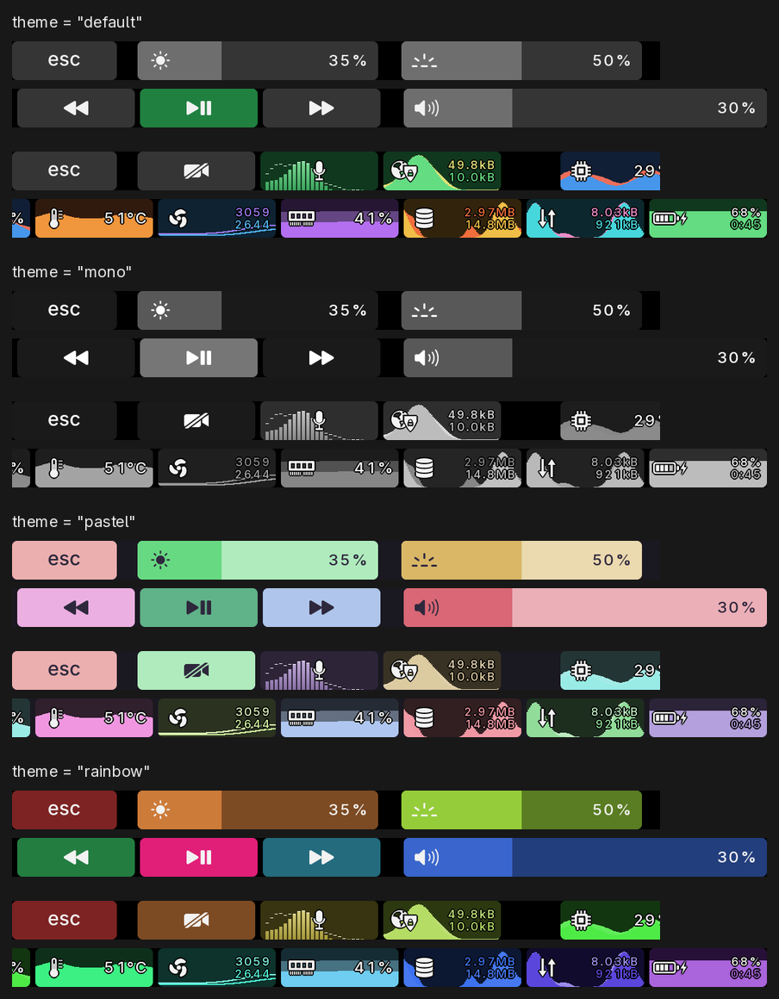

# fnstrip

A customizable Touch Bar renderer for T1 MacBook Pros running Linux with
[T1Bridge](https://github.com/standardagents/t1bridge). It replaces T1Bridge's built-in
renderer through T1Bridge's documented renderer selection, as an ordinary user process.

Not affiliated with or endorsed by Apple or the T1Bridge project. "Touch Bar" is a trademark
of Apple Inc.

**Status: beta.** Tested on one machine so far: a 15" 2016 MacBookPro13,3 running T1Bridge
v0.1.12. Reports from other models are welcome.

## What it does

- **Controls row:** Esc, sliders for display brightness, keyboard backlight and volume that
  show the current level and follow your finger, and media buttons. Tap the speaker icon to
  mute, or the keyboard icon to turn the backlight off (and back on to its level). Volume and
  media need a desktop provider (below).
- **F-keys:** Esc and F1-F12 while Fn is held (or swap the rows with `default_row`).
- **Extras row:** double-tap Fn; it stays until the next Fn press. Esc, your own toggle
  buttons, and live CPU, memory, disk and network graphs, CPU temperature, fan speeds
  and a battery gauge (with a bolt while on power, and the time to empty or full). A lit mic button shows a spectrum,
  a lit camera button its picture, and a lit VPN button its traffic.
- **Debug gestures** (`debug_gestures = "on"`; off by default): triple-tap Fn and hold for the
  test screen (animations with frame-rate stats), quad-tap Fn for the next theme (until restart).

## Requirements

- A working T1Bridge install, at the version pinned in `Cargo.toml`.
- Rust 1.88 or newer, to build.
- `brightnessctl` for the brightness and keyboard sliders.
- PipeWire tools (`pw-record`, `wpctl`) for the mic button and spectrum.
- A T1Bridge desktop provider for volume, mute and media. T1Bridge doesn't ship one;
  `contrib/desktop-provider` has a small generic one (needs `wpctl` and `busctl`).
- Optional: `ffmpeg`, for the camera (see `contrib/t1-webcam`).

## Install

```sh
cargo build --release
install -Dm755 target/release/fnstrip ~/.local/bin/fnstrip
mkdir -p ~/.config/t1bridge
ln -sfn ~/.local/bin/fnstrip ~/.config/t1bridge/renderer
systemctl --user restart t1-touchbar.service
```

If fnstrip can't start or exits, T1Bridge's launcher falls back to its built-in renderer.

For the volume slider, mute and media buttons, install the desktop provider (skip this if
your desktop already has one set):

```sh
install -Dm755 contrib/desktop-provider/fnstrip-desktop-provider ~/.local/bin/fnstrip-desktop-provider
mkdir -p ~/.config/systemd/user/t1-touchbar.service.d
printf '[Service]\nEnvironment=T1BRIDGE_DESKTOP_PROVIDER=%%h/.local/bin/fnstrip-desktop-provider\n' \
  > ~/.config/systemd/user/t1-touchbar.service.d/fnstrip-provider.conf
systemctl --user daemon-reload
systemctl --user restart t1-touchbar.service
```

Media buttons control the first MPRIS player on the session bus, and only work while one is
running.

To go back to the built-in renderer:

```sh
rm ~/.config/t1bridge/renderer
systemctl --user restart t1-touchbar.service
```

## Configure

Copy `config/default.toml` to `~/.config/fnstrip/config.toml`; its comments describe every
setting. Restart `t1-touchbar.service` to apply. A broken config falls back to the built-in
default, and the error goes to `journalctl --user -u t1-touchbar.service`.

Temperatures show in °C; `temperature_unit = "f"` shows °F.

Themes: `theme = "mono"`, `"pastel"` or `"rainbow"` (or the default) colours the whole bar,
meters and spectra included, and a `[colors]` section changes any single colour on top, as
`"#rrggbb"`.



Button commands run with `sh -c` as you, so treat this file like a shell script: whoever can
edit it can run commands as you. Read any config you didn't write (including one you
downloaded or edited from the project page) before you use it.

## Good to know

- **What it runs and reads:** fnstrip is an ordinary user process (no root, no setuid). Besides
  your config's commands, it starts only `busctl` (is media playing?), `pw-record` (the mic
  spectrum while the mic button is lit; the speakers' spectrum while media plays and the
  controls row shows), `ffmpeg` (the camera, while its button is lit), `brightnessctl`,
  `systemctl` and `date`, each without a shell. Sound and pictures are analysed in memory
  and never saved. Touch ID stays entirely T1Bridge's: fnstrip only reads its state file to
  draw the prompt.

- **Full frames:** normal bar updates are always sent as whole frames, at most 40 a second.
  On the tested machine, partial updates of every shape tried made the panel stop answering
  for about a second on a few percent of frames (`appletbdrm ... Failed to read response
  (-110)`), which froze touch input too. Whole frames never did. The test screen still sends
  partial updates, so it can show this.
- **Debugging:** while `$XDG_RUNTIME_DIR/fnstrip-record` exists, fnstrip logs events and saves
  every frame to `~/.cache/fnstrip-record` (several MB a second). `tools/record_video.py`
  makes a video from that, with touches drawn on.
- **Upstream changes:** the renderer here is a modified copy of T1Bridge's, so its later fixes
  need merging by hand.

## How it was made

Written with substantial help from an AI coding assistant (Claude), under human direction and
testing.

## License

MIT; see `LICENSE`. Third-party code, icons and fonts are listed in `THIRD_PARTY_NOTICES.md`.
